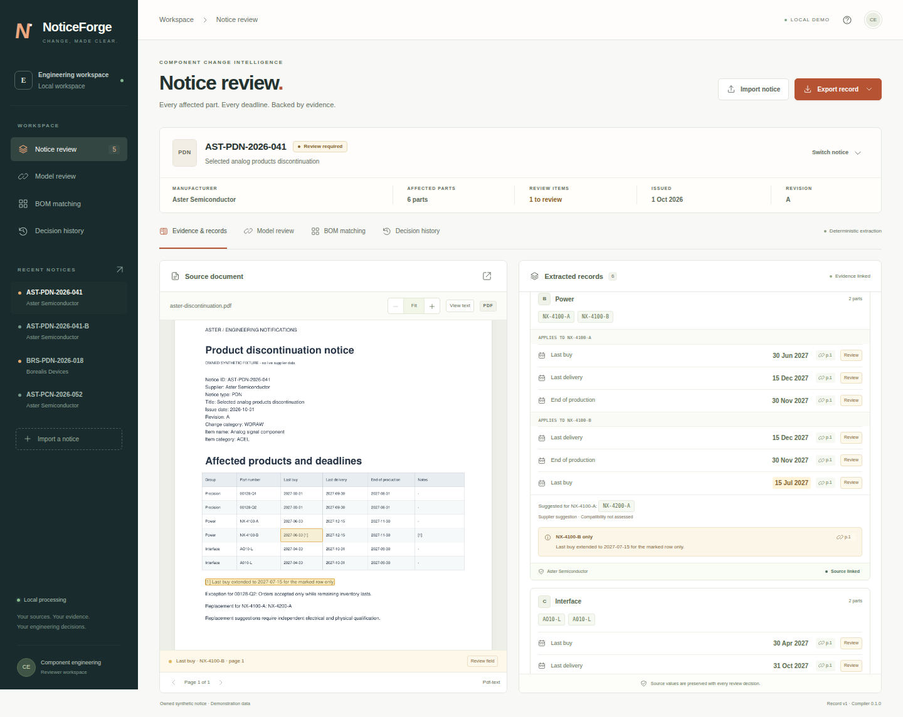

# NoticeForge — Source-linked product notice review

NoticeForge extracts structured records from semiconductor product-change and discontinuance notices, then lets a reviewer check each finding against the original document.

Use the local review workspace to trace each part, deadline, footnote and exception to its source, record corrections, match a BOM and export reviewed records. Deterministic rules are the default extractor; optional ML experiments measure alternatives and retain their negative results.

[Project page](https://ah682.github.io/noticeforge/) · [Walkthrough](docs/WALKTHROUGH.md) · [Model experiments](docs/MODELS.md) · [Architecture](docs/ARCHITECTURE.md)

**Stack:** Python, PyTorch, Hugging Face Transformers, PEFT/LoRA, FastAPI, Pydantic, SQLite, PyMuPDF, Tesseract, JavaScript, Playwright, and GitHub Actions. The ML and OCR dependencies are optional.



## Review workflow

1. Open an example or upload a permitted notice. Inspect extracted parts and deadlines beside their source text/PDF regions.
2. Resolve ambiguous dates and exceptions, recording sourced corrections and review decisions.
3. Match a BOM by exact part/manufacturer, then export canonical JSON or the supported smartPCN XML body.

The five fictional examples run without a model, API key or GPU. Start with **AST-PDN-2026-041** for grouped deadlines and a row-specific footnote.

## Implementation and optional ML experiments

- **Document processing:** PDF text and table-layout extraction, optional OCR, and source citations with exact text offsets and page coordinates. Typed records retain uncertain values and incomplete source coverage.
- **Data preparation:** Owned synthetic notices, structured annotations, permission records, and audits for supplier, template, revision-family, and near-duplicate leakage across splits. Evaluation inputs and configurations are frozen before the model comparison.
- **LLM fine-tuning:** Qwen2.5-0.5B-Instruct adapted with PEFT LoRA on CPU. The recorded run trained 540,672 parameters over 24 optimizer steps using 16 training documents and four separate validation documents, with checkpoint hashes and reload checks.
- **Inference experiments:** Seven measured profiles covering untuned and adapted models, padded batching, CPU dynamic INT8 quantization, and a larger Qwen2.5-1.5B comparator. Reports retain raw outputs, validation failures, latency, and peak memory.
- **Model validation:** Structured output is checked against a strict schema, exact source quotes, identifier boundaries, and date evidence. Invalid proposals are rejected; surviving proposals still require an explicit review decision.
- **Application integration:** A persistent model queue, source-linked proposal review, audited accept/reject decisions, and JSON/XML exports connect the experiments to a usable FastAPI and SQLite application.

The main implementation entry points are the [dataset pipeline](noticeforge/datasets.py), [training code](noticeforge/training.py), [provider adapters](noticeforge/providers.py), [model service](noticeforge/model_service.py), and [experiment runner](scripts/model_verification.py).

## Measured results

The recorded comparison uses **eight synthetic development cases**. These results describe that small corpus; they do not establish accuracy on unfamiliar supplier notices.

| Approach | Recorded result |
| --- | --- |
| Rules baseline | 18/19 exact part/date relationships and 15/16 exact parts, with zero unsupported assertions. One ragged table row remains a counted omission. |
| Qwen LoRA adaptation | Schema-valid responses increased from 1/8 to 7/8, but no proposed relationship passed the full evidence checks. Validation loss increased from 0.3220 to 0.3292. |
| Seven model serving profiles | Every profile recovered 0/19 evidence-valid relationships. Batching, quantization, and the larger comparator did not produce a usable extraction improvement on this set. |

The rules pipeline therefore remains the default extractor. Models are available for explicit proposal review, with their failures and resource costs preserved in the [comparison report](reports/model-verification/comparison.txt) and [evaluation notes](docs/EVALUATION.md).

## Run it locally

You need Python 3.12 and [uv](https://docs.astral.sh/uv/).

```bash
git clone https://github.com/ah682/noticeforge.git
cd noticeforge
make demo
```

Open **http://127.0.0.1:8877**. The command installs the locked dependencies, adds five example notices, and starts the app. No API key, GPU, model download, or paid service is needed.

The examples are fictional. Your uploaded notices and review history stay in a local SQLite database. Set `NOTICEFORGE_DATA_DIR` to use a different storage directory, or `NOTICEFORGE_PORT` to change the port. Other settings are listed in [`.env.example`](.env.example); export them in your shell before starting the app.

To reproduce the model experiments, follow the separate environment and training instructions in [Models](docs/MODELS.md). Published artifacts include configurations, checkpoint manifests, and measured reports; model weights must be downloaded or regenerated locally.

## What it does

- Keeps exact part identifiers and manufacturer context, including leading zeros and suffixes.
- Assigns dates to the right parts instead of using one deadline for the whole notice.
- Preserves footnotes, inventory conditions, exclusions, and partial revisions.
- Links extracted values to source text and PDF regions.
- Records review decisions, corrections, and original values.
- Matches BOM rows by literal identifier and manufacturer.
- Exports canonical JSON and a restricted smartPCN XML body validated against the original COGD XSD.

Try **AST-PDN-2026-041** for grouped deadlines and a row-specific footnote. **BRS-PDN-2026-018** shows an ambiguous date that needs review. **AST-PCN-2026-052** supports the XML export. The [walkthrough](docs/WALKTHROUGH.md) covers these examples.

## Development

```bash
make verify                 # tests, lint, types, evaluation, and CPU training smoke
npm ci
npm run format:check
make distribution-check     # build and exercise an installed wheel
```

Node 24 is used for the development checks. To run browser tests, start a disposable demo in another terminal:

```bash
NOTICEFORGE_DATA_DIR=/tmp/noticeforge-browser-check make demo
# In another terminal:
npm run test:browser
npm run test:races
```

Browser checks use Chrome; set `CHROME_PATH` if it is installed elsewhere. `make format` runs the Python and frontend formatters.

`make reset` deletes the selected demo database and its review history, then restores the example notices. Keep retained work in a separate data directory.

## Current limits

This is a single-user local application. It has no login or tenant isolation, so it should not be exposed directly as a public service. GitHub Pages can show a project page; it cannot run the Python backend or SQLite storage.

CPU inference and LoRA training have been exercised. CUDA/QLoRA execution, evaluation on an authorized real supplier corpus, and component-engineer usability studies remain unverified. OCR output always requires review.

The XML export is a restricted **smartPCN 3.0 body using XSD revision 3.08**, not a complete `.smartPCN` archive. Suggested replacement parts are never treated as approved substitutes.

## Further reading

- [Contributing](CONTRIBUTING.md) · [Release notes](CHANGELOG.md) · [Independent trial protocol](docs/EXTERNAL_EVALUATION.md)
- [Verification](docs/VERIFICATION.md) — checks, results, and acceptance cases.
- [Data](docs/DATA.md) — fixture permissions, annotations, and split rules.
- [Models](docs/MODELS.md) — optional training, inference, and measured comparisons.
- [Evaluation](docs/EVALUATION.md) — metrics and known failures.
- [smartPCN](docs/SMARTPCN.md) — supported mappings and export boundaries.
- [Limitations](docs/LIMITATIONS.md) — unsupported inputs and remaining validation work.

The fictional fixtures are CC0. Vendored schema material belongs to COGD and retains its [source and permission record](schemas/smartpcn/SOURCE.json). PyMuPDF has AGPL/commercial licensing terms. A project-wide license has not yet been selected.
